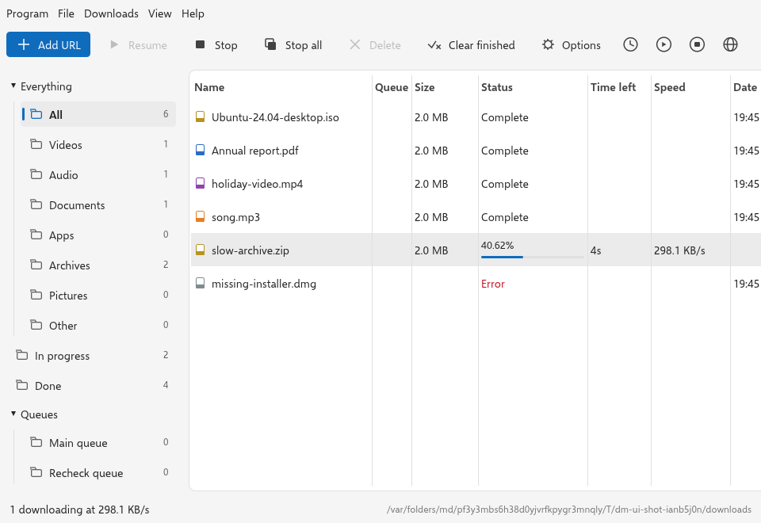

# Easy Download Manager (dm)

A free download manager for Windows, macOS and Linux. It downloads files
faster by using several connections at once, picks up where it left off
when your internet drops, and takes over the downloads you start in your
browser.

<picture>
  <source media="(prefers-color-scheme: dark)" srcset="docs/screenshot-dark.png">
  
</picture>

You install two things, both free:

1. **The dm app**, which does the downloading.
2. **The browser extension**, which sends your downloads to the app.

---

## Step 1 — Download the files

Open the **[Releases page](https://github.com/pranavo72bex/Easy-Download-Manager/releases)**
and, under the newest release, open **Assets**. Download the file for your
computer, and the extension for your browser:

| Your computer | Download this file |
|---|---|
| Windows 10 or 11 | `dm_…_x64-setup.exe` |
| Mac with an Apple chip (M1 or newer) | `dm_…_aarch64.dmg` |
| Ubuntu, Debian, Linux Mint, Pop!_OS | `dm_…_amd64.deb` (`_arm64.deb` on ARM) |
| Fedora, openSUSE, RHEL | `dm-…x86_64.rpm` (`aarch64.rpm` on ARM) |
| Any other Linux | `dm_…_x86_64.AppImage` (`_aarch64.AppImage` on ARM) |

| Your browser | Download this file |
|---|---|
| Chrome, Edge, Brave, Vivaldi or Opera | `dm-chrome-….zip` |
| Firefox | Nothing to download: it installs from [Firefox Add-ons](https://addons.mozilla.org/en-US/firefox/addon/dm-download-manager/) |

Not built yet: Macs with an Intel chip.

## Step 2 — Install the app

dm is not signed with a paid certificate yet, so your computer will warn
you the first time. That is expected; here is how to get past it.

### Windows

1. If your browser says the file "isn't commonly downloaded" or might be
   harmful, open its downloads list and choose **Keep** (in Edge: **…** →
   **Keep** → **Show more** → **Keep anyway**).
2. Double-click `dm_…_x64-setup.exe`.
3. If you see **"Windows protected your PC"**, click **More info**, then
   **Run anyway**.
4. Click through the installer.

### Mac

1. Double-click `dm_…_aarch64.dmg`.
2. Drag **dm** into the **Applications** folder.
3. Open **Applications** and double-click **dm**. When macOS says it cannot
   check dm, click **Done** (or **Cancel**).
4. Open **System Settings → Privacy & Security**, scroll down, and click
   **Open Anyway** next to the message about dm. Confirm with your password.

Always open dm from **Applications**, not from the downloaded disk image.

### Ubuntu, Debian, Linux Mint

Double-click `dm_…_amd64.deb` and click **Install**. Or, in a terminal in
the folder you downloaded it to:

```sh
sudo apt install ./dm_*_amd64.deb
```

### Fedora, openSUSE, RHEL

In a terminal in the folder you downloaded it to:

```sh
sudo dnf install ./dm-*.rpm        # Fedora, RHEL
sudo zypper install ./dm-*.rpm     # openSUSE
```

### Any other Linux (AppImage)

1. Right-click `dm_…_x86_64.AppImage` → **Properties** → **Permissions**,
   and tick **Allow executing file as program**.
2. Double-click it.

Keep the AppImage where it is once you have opened it: your browser is
told where it lives. (If you move it, open it once from its new place.)

### Arch Linux

```sh
git clone https://github.com/pranavo72bex/Easy-Download-Manager
cd Easy-Download-Manager/desktop/packaging
makepkg -si
```

## Step 3 — Open dm once

Open **dm** from your Start menu, Applications folder or app menu. That is
all it takes: the first time it opens, dm tells your browsers where it is.

dm keeps running in the tray (Windows, Linux) or the menu bar (Mac) when you
close its window, so your browser always has it to hand downloads to.

Until you add the extension, dm shows a bar above its list with a button for
each browser: **Microsoft Edge**, **Firefox** and **Chrome and others**.
Click yours and it opens the page you add it from. (The same buttons are in
**Options › Browser**.)

## Step 4 — Add the extension

### Microsoft Edge

dm is on Microsoft Edge Add-ons, Microsoft's own store.

1. Open **[dm on Microsoft Edge Add-ons](https://microsoftedge.microsoft.com/addons/detail/ooafpfjpliofcdlnbdkjhonaoebcpnej)** in Edge.
2. Click **Get**, then **Add extension**.

### Chrome, Brave, Vivaldi and Opera

1. Unzip `dm-chrome-….zip`. Move the folder it makes somewhere it can stay,
   such as your Documents folder. **Do not delete this folder later** — the
   browser loads the extension from it.
2. Open the extensions page by typing this in the address bar:
   - Chrome: `chrome://extensions`
   - Edge: `edge://extensions`
   - Brave: `brave://extensions`
   - Vivaldi: `vivaldi://extensions`
   - Opera: `opera://extensions`
3. Turn on **Developer mode** (top right; in Edge it is on the left).
4. Click **Load unpacked** and choose the folder from step 1.
5. Close the browser completely and open it again.

### Firefox

dm is on Firefox Add-ons, Mozilla's own store.

1. Open **[dm — Download Manager on Firefox Add-ons](https://addons.mozilla.org/en-US/firefox/addon/dm-download-manager/)** in Firefox.
2. Click **Add to Firefox**, then **Add**.
3. If Firefox asks, allow it to run in private windows only if you want it
   to; dm leaves private-window downloads with the browser either way.

**If Firefox Add-ons says it is not available yet** (a new version waits
in Mozilla's review), install the copy Mozilla has already signed from the
Releases page instead. It is the same extension, and it stays installed:

1. On the **[Releases page](https://github.com/pranavo72bex/Easy-Download-Manager/releases)**,
   find the newest release with a `dm-firefox-….xpi` file and click it
   *in Firefox*.
2. Firefox asks whether to allow the site to install an add-on: click
   **Continue to Installation**, then **Add**.

On Ubuntu, where Firefox comes as a Snap, open dm once *before* adding the
extension, so that it can tell Firefox where it is. If you installed Firefox
while dm was already running, open dm again (from the Start menu,
Applications folder or app menu): it connects to browsers installed since
each time you open it.

Firefox may briefly show its downloads panel when dm takes a download; dm
has the download. Firefox opens that panel itself for every download it
starts, sooner than dm can hear back from the app, and does not let an
extension turn it off. When dm's was the only download listed, the panel
closes again by itself; with older downloads listed it stays open showing
them, until you click elsewhere or press Esc.

## Step 5 — Try it

Click a download link on any website, for example a `.zip` or `.exe` file.
It appears in dm instead of in the browser, and downloads there.

- **Download a video:** play it, move the mouse over it and click
  **Download video** in its top corner, then pick a quality. That is all:
  YouTube and most video sites work straight away, with nothing else to
  install. The very first video takes a little longer while dm gets ready
  for videos; its row says so.
- **Hide the video panel:** click its **×**: **Hide for now**, or **Never on
  this site**.
- **The dm icon in the toolbar** opens a small menu: whether dm is
  connected, **Catch downloads** on or off, the video panel on this site on
  or off, and **Open dm**. It never downloads anything by itself.
- **Download a link:** right-click it and choose **Download link with dm**.
- **Add a link by hand:** in dm, click **Add URL** and paste it. Web
  (`https://`), FTP (`ftp://`) and magnet links all work.
- **Drag a link** from the browser onto dm's window to download it.
- **Change the language:** **View › Language** — English, Español,
  Português, Français, Deutsch, Italiano, Nederlands, Polski, Русский,
  Bahasa Indonesia, Türkçe, 简体中文, 日本語 or 한국어. dm starts in your
  computer's language when it has it. Chinese, Japanese and Korean are drawn
  in your computer's own font for them.

### How video downloads work

You do not need to install anything for video.

- **The first video takes a little longer.** dm downloads the part of
  itself that finds the video behind a site's player (about 35 MB, once,
  checked before it is kept) and keeps it up to date by itself, since
  video sites change often. The video's row says "Getting ready for videos
  (first time only)" while this happens. Every video after that starts
  straight away.
- **Picture and sound in one file.** Sites send picture and sound
  separately. dm joins them into one file, in MP4 or WebM, at the quality
  you picked, 4K included. Live streams (`rtmp://`, `rtmpt://`, `rtsp://`,
  `rtsps://`, `mms://`), HLS playlists and subtitles are handled by dm too.

The extension sends the page's sign-in along with the video, so a site that
checks you are not a bot lets the download through.

## If something is not working

- **Downloads still go to the browser.** Click the dm icon in the browser's
  toolbar: it says whether dm is connected, and if not, why. Check that
  **Catch downloads** is on there. Open dm once (it connects itself to your
  browsers when it opens), then close the browser completely and open it
  again. If dm shows a message at the top of its window, it says what is
  wrong.
- **Mac says dm "is damaged", or there is no Open Anyway button.** Open
  **Terminal** and run
  `xattr -dr com.apple.quarantine /Applications/dm.app`, then open dm again.
- **The AppImage does not start (Ubuntu 22.04 or newer).** Run
  `sudo apt install libfuse2`.
- **File names in Chinese, Japanese or Korean show as blanks (Linux).**
  dm draws them with a font your computer has, and this one has none for
  them. On Ubuntu or Debian run `sudo apt install fonts-noto-cjk`; the
  Fedora, openSUSE and Arch packages suggest one when dm is installed.
- **No tray icon on Linux.** dm's icon shows in any panel that shows
  "StatusNotifier" icons: KDE, Ubuntu's GNOME, Cinnamon, Xfce, LXQt, and
  waybar on niri, Sway or Hyprland. On other GNOME (Fedora, Debian) turn on
  the "AppIndicator and KStatusNotifierItem Support" extension. With no such
  panel, closing dm's window quits dm rather than hiding it where you could
  not get it back.
- **A download needs you to be signed in** (it finishes in the browser, or
  a video says to sign in or prove you are not a bot). Export your
  browser's cookies as `cookies.txt` with any "Get cookies.txt" add-on, then
  in dm choose it under **Options › Network › Cookies file**. dm then
  sends those cookies itself, and gives them to yt-dlp.

## Uninstall

First tell your browsers dm is going, and remove its login item (Start on
login), so nothing is left pointing at a program that is not there. Quit dm,
then run:

- **Windows:** in Command Prompt,
  `start "" /wait "%LOCALAPPDATA%\dm\dm-desktop.exe" --unregister`, or in
  PowerShell,
  `Start-Process -Wait -NoNewWindow "$env:LOCALAPPDATA\dm\dm-desktop.exe" --unregister`.
  dm is a windowed program, so without `start /wait` (or `-Wait`) the prompt
  comes back before dm has finished and what it says lands after it;
  `echo %errorlevel%` then shows 0 for success. dm's uninstaller also runs
  this before it removes the files.
- **Mac:** `/Applications/dm.app/Contents/MacOS/dm-desktop --unregister`
- **Ubuntu / Debian (.deb):** `dm-desktop --unregister`
- **Fedora / openSUSE / Arch:** `dm --unregister`
- **AppImage:** `/path/to/dm.AppImage --unregister`

It says each thing it removed. Then remove the app:

- **Windows:** Settings → Apps → **dm** → Uninstall.
- **Mac:** drag **dm** from Applications to the Bin.
- **Ubuntu / Debian:** `sudo apt remove dm`.
- **Fedora / openSUSE:** `sudo dnf remove dm` or `sudo zypper remove dm`.
- **Arch:** `sudo pacman -R dm`.
- **AppImage:** delete the file.
- **Extension:** remove it from your browser's extensions page.

Your settings, the download list and its history stay in dm's own folder,
in case you install it again. Delete that folder too if you want them gone:

- **Windows:** `%LOCALAPPDATA%\dm-engine`
- **Mac:** `~/Library/Application Support/dm-engine`
- **Linux:** `~/.local/share/dm-engine`

The window's size and place are kept in one more folder:
`%APPDATA%\dm\data` on Windows, `~/Library/Application Support/dm` on a
Mac, `~/.local/share/dm` on Linux.

## Use it responsibly

Only download what you have the right to download. dm does not get around
DRM, paywalls, sign-ins or any other protection: what a website does not
let you download, dm does not either.

## Free, with nothing tracked

dm is free and open source under the [MIT licence](LICENSE). It has no
ads, no accounts and no analytics, and it sends nothing about you anywhere
(see [PRIVACY.md](PRIVACY.md)).

## For developers

How dm is built, tested and measured: [docs/how-it-works.md](docs/how-it-works.md).
Where to start changing it: [AGENTS.md](AGENTS.md). The open work list:
[docs/gaps.md](docs/gaps.md).
