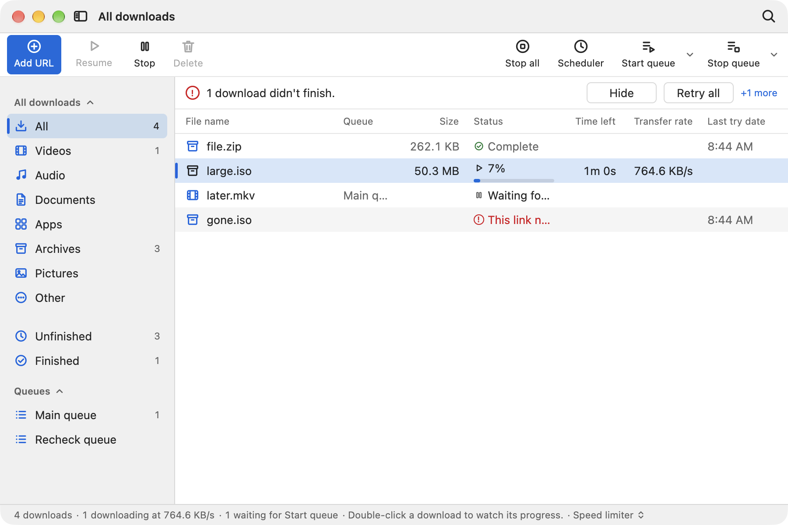
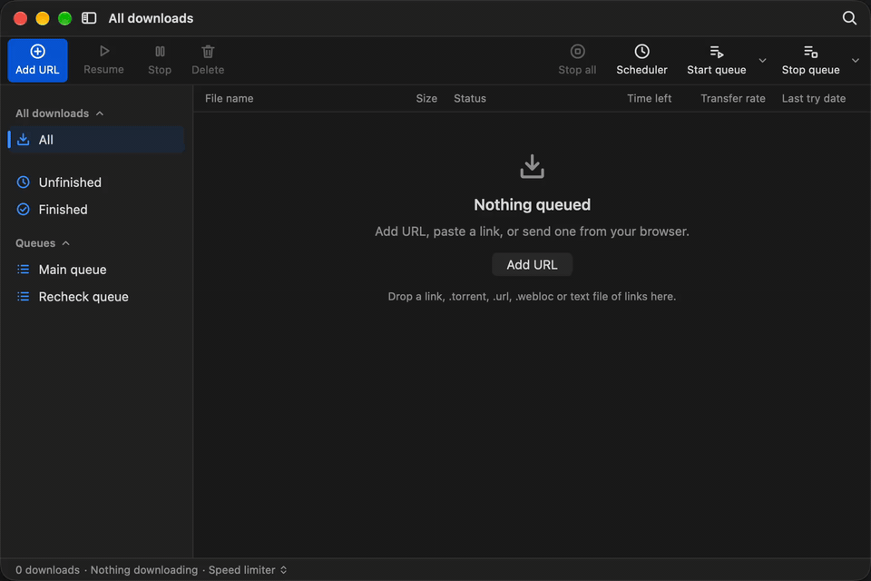
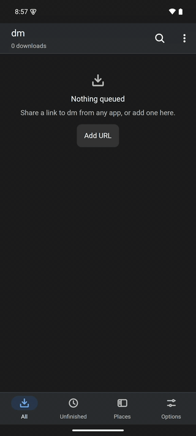
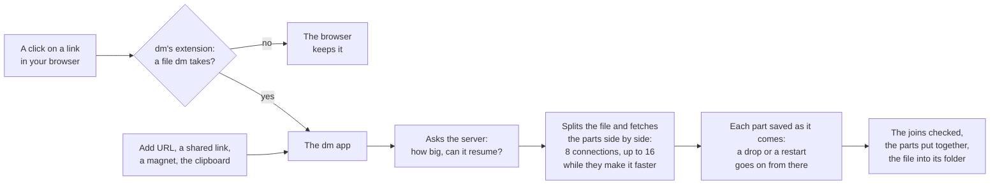
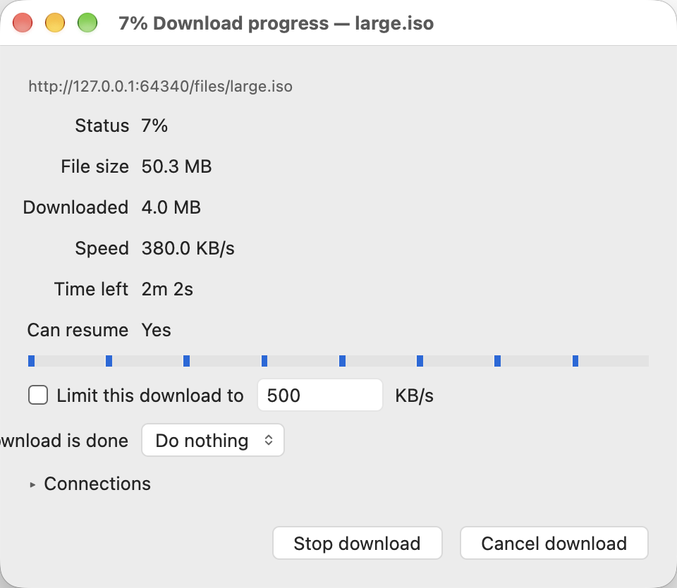
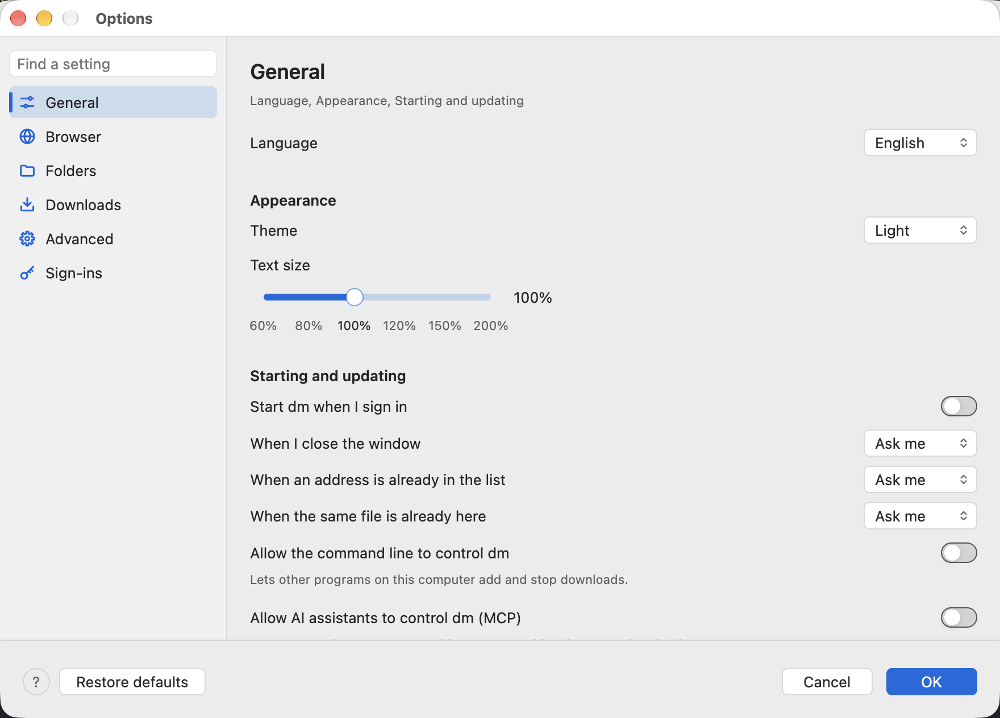
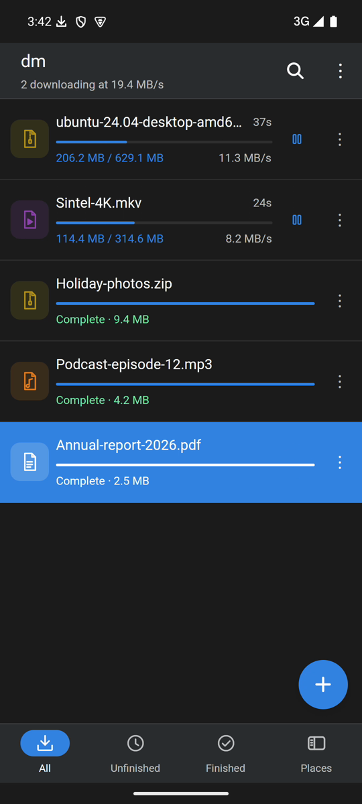
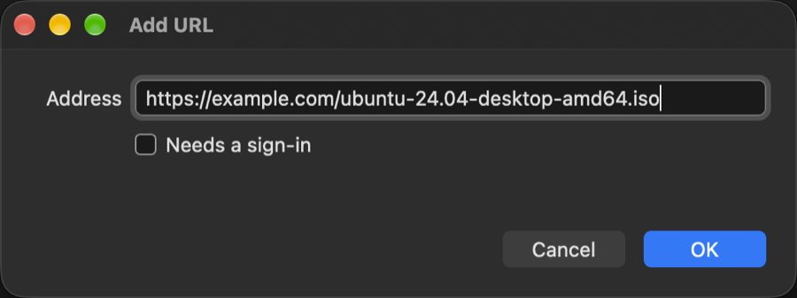
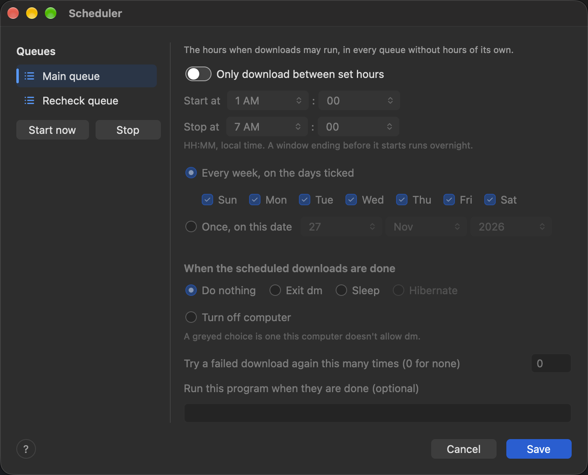

<h1 align="center">Easy Download Manager (dm)</h1>

<p align="center"><strong>Faster downloads, picked up where they left off.</strong></p>

<p align="center">
  <a href="https://github.com/pranavo72bex/Easy-Download-Manager/releases"></a>
  <a href="https://github.com/pranavo72bex/Easy-Download-Manager/releases"></a>
  <a href="LICENSE"></a>
  <a href="https://microsoftedge.microsoft.com/addons/detail/ooafpfjpliofcdlnbdkjhonaoebcpnej"></a>
  <a href="https://addons.mozilla.org/en-US/firefox/addon/dm-download-manager/"></a>
  <a href="https://idmo.app/p/easy-download-manager"></a>
  <a href="https://github.com/pranavo72bex/Easy-Download-Manager/stargazers"></a>
</p>

<p align="center">
  <a href="https://github.com/pranavo72bex/Easy-Download-Manager/releases"></a>
  <a href="https://github.com/pranavo72bex/Easy-Download-Manager/releases"></a>
  <a href="https://github.com/pranavo72bex/Easy-Download-Manager/releases"></a>
  <a href="https://github.com/pranavo72bex/Easy-Download-Manager/releases"></a>
</p>

<p align="center"><sub>Free and open source · no ads, no account, no trial · Windows 10 and 11, macOS, Linux, Android 10 and newer · 14 languages</sub></p>

<picture>
  <source media="(prefers-color-scheme: dark)" srcset="docs/screenshot-dark.png">
  
</picture>

| 🚀 [Download](#step-1--download-the-files) | ✨ [Why dm](#why-dm) | 🎬 [Demo](#see-it-in-action) | ⚙️ [How it works](#how-dm-works) | 🧰 [What it does](#what-it-does) | 📱 [On your phone](#on-your-phone-android) | 🖼️ [Screenshots](#screenshots) | 🛠️ [Install](#install) | ❓ [FAQ](#faq) | 🌍 [Languages](#languages) | 📖 [User guide](docs/user-guide.md) | 💻 [Developers](#for-developers) |
| --- | --- | --- | --- | --- | --- | --- | --- | --- | --- | --- | --- |

dm is a free download manager for Windows, macOS, Linux and Android phones. It
downloads files faster by using several connections at once, picks up where it
left off when your internet drops, and takes over the downloads you start in
your browser. On a computer you install two things, both free: **the dm app**,
which does the downloading, and **the browser extension**, which sends your
downloads to it. On a phone, the app alone.

## Why dm

- **Fast where downloads are slow.** Up to 16 connections a file, and more only
  while they make it faster: a server that slows each connection gets them all,
  and one that refuses extra connections is never flooded.
- **Nothing is lost.** A dropped connection, a sleep or a restart: dm goes on
  from the last byte it saved, and checks the joins between the parts so a file
  that changed while it downloaded is caught, not saved broken.
- **Everything in one place.** Web, FTP, torrents and magnet links, and the
  videos on a page (YouTube included), with queues, a scheduler and limits.
- **The same app everywhere.** Windows, macOS, Linux and Android share one
  window and one engine, written from scratch in Rust: no ads, no account, no
  trial.
- **Private.** It sends nothing about you anywhere; it reaches other computers
  only to fetch what you ask for, and to look for a new version if you turn
  that on ([PRIVACY.md](PRIVACY.md)).

## See it in action

<table>
  <tr>
    <td align="center" width="72%">
      
      <br><sub><strong>On a computer</strong>: downloads side by side, and one's own window</sub>
    </td>
    <td align="center" width="28%">
      
      <br><sub><strong>On a phone</strong>: links shared to dm</sub>
    </td>
  </tr>
</table>

<sub>Recorded with made-up files from a server on the same computer.</sub>

## How dm works



1. **Catching.** The extension looks at each download the browser starts. A
   file type dm takes goes to the app over the browser's own channel to
   programs on your computer (native messaging); anything else, and everything
   when dm is not running, stays with the browser.
2. **Asking.** dm asks the server how big the file is and whether it can send
   it in parts. A server that cannot is downloaded in one piece, as a browser
   would.
3. **Fetching.** The file is split into parts fetched at the same time. A part
   that finishes takes over half of the slowest one, so no single slow
   connection holds the download up, and more connections are added only while
   they raise the speed.
4. **Keeping.** Every part is written to disk as it arrives, with a note of how
   far it got. A lost connection is tried again by itself; a closed laptop, a
   restart or a crash goes on from the last byte saved.
5. **Finishing.** The bytes on each side of every join are asked for again and
   compared, so a file that changed on the server while it downloaded is caught
   rather than saved broken. Then the parts become one file, sorted into a
   folder by its kind.

Torrents, videos from a page (picture and sound joined into one file) and
streams have engines of their own beside this one. The whole design:
[docs/how-it-works.md](docs/how-it-works.md).

## Quick start

1. **Get the app** for your computer from the [Releases page](https://github.com/pranavo72bex/Easy-Download-Manager/releases) and install it ([how](#install)).
2. **Open dm once.** It tells your browsers where it is.
3. **Add the extension** from [Edge Add-ons](https://microsoftedge.microsoft.com/addons/detail/ooafpfjpliofcdlnbdkjhonaoebcpnej), [Firefox Add-ons](https://addons.mozilla.org/en-US/firefox/addon/dm-download-manager/), or the release's `dm-chrome-….zip` for Chrome, Brave, Vivaldi and Opera.

Then click any download link: it lands in dm.

## What it does

| Feature | What happens |
| --- | --- |
| **Several connections at once** | A file is split into parts fetched side by side, and a slow part is helped by the others. |
| **Resume after a drop** | A lost connection, a sleep or a restart: the download goes on from where it stopped. |
| **Takes over the browser's downloads** | Click a link and it lands in dm, not the browser. Alt-click leaves it with the browser. |
| **Videos from the page** | Play a video and click **Download video** in its corner, then pick a quality. YouTube needs nothing extra. |
| **Queues, schedule and limits** | Queues, a scheduler, a speed limit for everything or for one site, and a folder per site. |
| **Your downloads in the browser's toolbar** | The extension's popup lists what dm is fetching, how far and how fast, and its last failure. |
| **Driven from a terminal or an AI assistant** | `dm-desktop list`, `pause`, `resume`; or any MCP client, with no key and nothing sent off your computer. |
| **Torrents** | Magnet links and `.torrent` files: peers found in seconds, the files you tick, sharing only when you turn it on. |
| **Checked files** | Each download's SHA-256 in its Properties, and a box to check it against the one a site gives. |
| **On your phone too** | The same app on Android 10 and newer: share a link to it from any app ([more](#on-your-phone-android)). |

## Screenshots

<table>
  <tr>
    <td align="center" width="50%">
      <picture>
        <source media="(prefers-color-scheme: dark)" srcset="docs/progress-dark.png">
        
      </picture>
      <br><sub><strong>Every download's own window</strong>: speed, time left, and each connection's part</sub>
    </td>
    <td align="center" width="50%">
      <picture>
        <source media="(prefers-color-scheme: dark)" srcset="docs/settings-dark.png">
        
      </picture>
      <br><sub><strong>Options</strong>: light or dark, 14 languages, a setting found by typing</sub>
    </td>
  </tr>
  <tr>
    <td align="center" width="50%">
      
      <br><sub><strong>On a phone</strong>: the same app, each download a card</sub>
    </td>
    <td align="center" width="50%">
      <picture>
        <source media="(prefers-color-scheme: dark)" srcset="docs/screenshot-dark.png">
        
      </picture>
      <br><sub><strong>The main window</strong>: places on the left, every download with its size, status, time left and speed</sub>
    </td>
  </tr>
  <tr>
    <td align="center" width="50%">
      
      <br><sub><strong>Add URL</strong>: paste a link, and say if it needs a sign-in</sub>
    </td>
    <td align="center" width="50%">
      
      <br><sub><strong>The Scheduler</strong>: the hours and days a queue runs, and sleep or shut down after</sub>
    </td>
  </tr>
</table>

## Supported

| Kind | What dm takes |
| --- | --- |
| **Web** | `http://`, `https://`, through HTTP or SOCKS5 proxies, with sign-ins and cookies |
| **FTP** | `ftp://` and FTPS |
| **Torrents** | magnet links and `.torrent` files |
| **Streams** | HLS and DASH playlists, `rtmp://`, `rtmpt://`, `rtsp://`, `rtsps://`, `mms://` |
| **Browsers** | Chrome, Edge, Brave, Vivaldi, Opera and Firefox |
| **Systems** | Windows 10 and 11 (x64 and ARM), macOS (Apple chips and Intel), Linux on x86-64 and ARM (`.deb`, `.rpm`, AppImage, Arch), Android 10 and newer |
| **Languages** | English, Español, Português, Français, Deutsch, Italiano, Nederlands, Polski, Русский, Bahasa Indonesia, Türkçe, 简体中文, 日本語, 한국어 |

## On your phone (Android)


dm runs on Android 10 and newer, with the same engine and the same window as
on a computer, laid out for a phone: each download a card, the menus in one
sheet, a button to add a link.

- **Share a link to dm** from any app (the browser's Share, a chat), or open a
  magnet link or a `.torrent` file with it, and dm downloads it.
- **It keeps going** with the screen off and after you switch apps, and picks
  up where it stopped if the app is closed.
- **Torrents and magnet links** find their peers in seconds.

**Install:** on the
[Releases page](https://github.com/pranavo72bex/Easy-Download-Manager/releases),
open the newest `android-v…` release and download the APK for your phone, then
open it. Android asks once to allow installs from your browser or Files app:
allow it, and tap **Install**.

| Your phone | Download this file |
| --- | --- |
| Almost every phone from the last ten years | `dm-…-arm64-v8a.apk` |
| An older phone with a 32-bit processor | `dm-…-armeabi-v7a.apk` |
| An emulator or a Chromebook | `dm-…-x86_64.apk` |
| Not sure | `dm-…-universal.apk` (larger, works on all of them) |

Each APK has a `.sha256` file beside it with its checksum, and every APK is
signed with the same key, so a new version installs over the old one and keeps
your list. Building it yourself: [docs/android.md](docs/android.md).
<br clear="right">

## Install

### Step 1 — Download the files

Open the **[Releases page](https://github.com/pranavo72bex/Easy-Download-Manager/releases)**
and, under the newest release, open **Assets**. Download the file for your
computer, and the extension for your browser:

| Your computer | Download this file | Choose it when |
|---|---|---|
| Windows 10 or 11 | `dm_…_x64-setup.exe` | **Not sure? Take this one.** It installs dm and starts it when you sign in. |
| Windows 10 or 11, without installing | `dm_…_x64-portable.zip` | You want dm on a USB stick, or nothing written to the computer. |
| Windows on ARM (Snapdragon and other ARM laptops) | `dm_…_arm64-setup.exe` or `dm_…_arm64-portable.zip` | The same two, for an ARM processor. |
| Mac with an Apple chip (M1 or newer) | `dm_…_aarch64.dmg` | Most Macs from 2020 on. |
| Mac with an Intel chip | `dm_…_x64.dmg` | Older Macs. |
| Ubuntu, Debian, Linux Mint, Pop!_OS | `dm_…_amd64.deb` | `dm_…_arm64.deb` on an ARM computer. |
| Fedora, openSUSE, RHEL | `dm-…x86_64.rpm` | `dm-…aarch64.rpm` on an ARM computer. |
| Arch Linux | `dm-…-x86_64.pkg.tar.zst` | Or from the AUR, below. |
| Any other Linux | `dm_…_x86_64.AppImage` | `dm_…_aarch64.AppImage` on an ARM computer. |
| An Android phone | `dm-…-arm64-v8a.apk` | [On your phone](#on-your-phone-android) says which APK. |

| Your browser | Download this file |
|---|---|
| Chrome, Edge, Brave, Vivaldi or Opera | `dm-chrome-….zip` |
| Firefox | Nothing to download: it installs from [Firefox Add-ons](https://addons.mozilla.org/en-US/firefox/addon/dm-download-manager/) |

Every release lists each file's SHA-256 in `SHA256SUMS`, to check a download
was not changed on the way.

How the Windows installer is signed: see the [Code signing policy](#code-signing-policy).

### Step 2 — Install the app

dm is not signed with a paid certificate yet, so your computer will warn
you the first time. That is expected; here is how to get past it.

<details>
<summary><strong>Windows</strong></summary>

1. If your browser says the file "isn't commonly downloaded" or might be
   harmful, open its downloads list and choose **Keep** (in Edge: **…** →
   **Keep** → **Show more** → **Keep anyway**).
2. Double-click `dm_…_x64-setup.exe`.
3. If you see **"Windows protected your PC"**, click **More info**, then
   **Run anyway**.
4. Click through the installer.

</details>

<details>
<summary><strong>Windows, portable (no installer)</strong></summary>

Prefer not to install anything, or want dm on a USB stick? Download
`dm_…_x64-portable.zip` instead, unzip it anywhere and double-click
`dm-gpui.exe`. The empty file named `portable` beside it makes dm keep its
settings and its list in a `dm-data` folder next to it and write nothing else
to the computer; delete the folder and dm is gone. A portable dm does not start
when you sign in. To let the browser extension hand downloads to this copy, run
`dm-gpui.exe --register` once in its folder (and again if you move it).

</details>

<details>
<summary><strong>Mac</strong></summary>

1. Double-click `dm_…_aarch64.dmg` (`dm_…_x64.dmg` on an Intel Mac).
2. Drag **dm** into the **Applications** folder.
3. Open **Applications** and double-click **dm**. When macOS says it cannot
   check dm, click **Done** (or **Cancel**).
4. Open **System Settings → Privacy & Security**, scroll down, and click
   **Open Anyway** next to the message about dm. Confirm with your password.

Always open dm from **Applications**, not from the downloaded disk image.

</details>

<details>
<summary><strong>Ubuntu, Debian, Linux Mint</strong></summary>

Double-click `dm_…_amd64.deb` and click **Install**. Or, in a terminal in
the folder you downloaded it to:

```sh
sudo apt install ./dm_*_amd64.deb
```

</details>

<details>
<summary><strong>Fedora, openSUSE, RHEL</strong></summary>

In a terminal in the folder you downloaded it to:

```sh
sudo dnf install ./dm-*.rpm        # Fedora, RHEL
sudo zypper install ./dm-*.rpm     # openSUSE
```

</details>

<details>
<summary><strong>Any other Linux (AppImage)</strong></summary>

1. Right-click `dm_…_x86_64.AppImage` → **Properties** → **Permissions**,
   and tick **Allow executing file as program**.
2. Double-click it.

Keep the AppImage where it is once you have opened it: your browser is
told where it lives. (If you move it, open it once from its new place.)

</details>

<details>
<summary><strong>Arch Linux</strong></summary>

From the AUR, where [dm-appimage](https://aur.archlinux.org/packages/dm-appimage)
installs the release's AppImage (packaged and kept up by
[Cleboost](https://github.com/Cleboost/missing-aur), not by this project):

```sh
yay -S dm-appimage        # or paru, or any AUR helper
```

Or built from source, with the PKGBUILD in this repository:

```sh
git clone https://github.com/pranavo72bex/Easy-Download-Manager
cd Easy-Download-Manager/packaging
makepkg -si
```

</details>

### Step 3 — Open dm once

Open **dm** from your Start menu, Applications folder or app menu. That is
all it takes: the first time it opens, dm tells your browsers where it is.

dm keeps running in the tray (Windows, Linux) or the menu bar (Mac) when you
close its window, so your browser always has it to hand downloads to.

Until you add the extension, dm shows a bar above its list with a button for
each browser: **Microsoft Edge**, **Firefox** and **Chrome and others**.
Click yours and it opens the page you add it from. (The same buttons are in
**Options › Browser**.)

### Step 4 — Add the extension

<details>
<summary><strong>Microsoft Edge</strong></summary>

dm is on Microsoft Edge Add-ons, Microsoft's own store.

1. Open **[dm on Microsoft Edge Add-ons](https://microsoftedge.microsoft.com/addons/detail/ooafpfjpliofcdlnbdkjhonaoebcpnej)** in Edge.
2. Click **Get**, then **Add extension**.

</details>

<details>
<summary><strong>Chrome, Brave, Vivaldi and Opera</strong></summary>

1. Unzip `dm-chrome-….zip`. Move the folder it makes somewhere it can stay,
   such as your Documents folder. **Do not delete this folder later** — the
   browser loads the extension from it.
2. Open the extensions page by typing this in the address bar:
   - Chrome: `chrome://extensions`
   - Edge: `edge://extensions`
   - Brave: `brave://extensions`
   - Vivaldi: `vivaldi://extensions`
   - Opera: `opera://extensions`
3. Turn on **Developer mode** (top right; in Edge it is on the left).
4. Click **Load unpacked** and choose the folder from step 1.
5. Close the browser completely and open it again.

</details>

<details>
<summary><strong>Firefox</strong></summary>

dm is on Firefox Add-ons, Mozilla's own store.

1. Open **[dm — Download Manager on Firefox Add-ons](https://addons.mozilla.org/en-US/firefox/addon/dm-download-manager/)** in Firefox.
2. Click **Add to Firefox**, then **Add**.
3. If Firefox asks, allow it to run in private windows only if you want it
   to; dm leaves private-window downloads with the browser either way.

**If Firefox Add-ons says it is not available yet** (a new version waits
in Mozilla's review), install the copy Mozilla has already signed from the
Releases page instead. It is the same extension, and it stays installed:

1. On the **[Releases page](https://github.com/pranavo72bex/Easy-Download-Manager/releases)**,
   find the newest release with a `dm-firefox-….xpi` file and click it
   *in Firefox*.
2. Firefox asks whether to allow the site to install an add-on: click
   **Continue to Installation**, then **Add**.

On Ubuntu, where Firefox comes as a Snap, open dm once *before* adding the
extension, so that it can tell Firefox where it is. If you installed Firefox
while dm was already running, open dm again (from the Start menu,
Applications folder or app menu): it connects to browsers installed since
each time you open it.

Firefox may briefly show its downloads panel when dm takes a download; dm
has the download. Firefox opens that panel itself for every download it
starts, sooner than dm can hear back from the app, and does not let an
extension turn it off. When dm's was the only download listed, the panel
closes again by itself; with older downloads listed it stays open showing
them, until you click elsewhere or press Esc.

</details>

### Step 5 — Try it

Click a download link on any website, for example a `.zip` or `.exe` file.
It appears in dm instead of in the browser, and downloads there.

- **Download a video:** play it, move the mouse over it and click
  **Download video** in its top corner, then pick a quality. That is all:
  YouTube and most video sites work straight away, with nothing else to
  install. The very first video takes a little longer while dm gets ready
  for videos; its row says so.
- **Hide the video panel:** click its **×**: **Hide for now**, or **Never on
  this site**.
- **Only a part of a video:** in dm, **Add URL** with the video's address,
  and in Download details tick **Only a part of the video** and give from
  and to, such as 4:10 and 4:45. Only that part is fetched, as the site's
  own picture and sound, cut to the second. (YouTube today.)
- **A playlist or a channel:** **Add URL** with a YouTube or YouTube Music
  playlist address lists its videos with a tick each; pick the quality, or
  sound alone, and start. A channel's address (`/@name`, `/channel/…`,
  `/c/…`, `/user/…`, or one of its tabs) lists the channel's uploads.
- **The dm icon in the toolbar** opens a small menu: whether dm is
  connected, **Catch downloads** on or off, the video panel on this site on
  or off, and **Open dm**. It never downloads anything by itself.
- **Download a link:** right-click it and choose **Download link with dm**.
- **Add a link by hand:** in dm, click **Add URL** and paste it. Web
  (`https://`), FTP (`ftp://`) and magnet links all work.
- **Drag a link** from the browser onto dm's window to download it.
- **Unzip a finished download:** right-click a `.zip` in dm's list and choose
  **Extract here** (a new folder beside it) or **Extract to…** (a new folder
  inside one you pick). Nothing is replaced, the zip is kept, and a zip
  with an entry that would land outside the folder, a link, or a password
  is refused whole before anything is written.
- **Save links in a folder:** in **Options › Downloads**, name a folder to
  watch. A `.url`, `.webloc` or text file of links, or a `.torrent`, saved
  there is added to dm and moved into a `done` folder inside it (nothing is
  deleted). Leave it empty to turn it off.
- **Give a site its own folder and speed:** **Options › Advanced › Network › Sites
  with their own folder, speed and headers** (the site's subdomains are
  covered). A folder or speed you pick for one download still wins. A site
  rule can also give a **User-Agent** and **Request headers** for that site.
- **A server that wants its own User-Agent or headers:** a download's
  **Properties** has **User-Agent** and **Request headers** fields. The name
  given is sent on every request of that download in place of dm's, and the
  headers, written `Name: value | Name: value`, go only to the download's
  own server.
- **Check a finished file:** **Properties** shows its SHA-256 and a box to
  check it against a digest you were given (MD5, SHA-256 or SHA-512).
  **Move/Rename** of several files takes a name pattern, such as
  `Trip {n} ({name})`; the endings are kept.
- **Change the language:** **View › Language** — English, Español,
  Português, Français, Deutsch, Italiano, Nederlands, Polski, Русский,
  Bahasa Indonesia, Türkçe, 简体中文, 日本語 or 한국어. dm starts in your
  computer's language when it has it. Chinese, Japanese and Korean are drawn
  in your computer's own font for them.

## More

<details>
<summary><strong>From a terminal</strong></summary>

Turn on **Options › General › Allow the command line to control dm** (off until you do), or start dm with `--control 0` (also
`--headless --control 0` for no window), and another terminal can see and
steer its downloads:

```sh
dm-desktop list                # what is downloading, one line each  (--json too)
dm-desktop status 3            # one download, by the number `list` gives
dm-desktop pause 3 4           # or: resume, cancel
dm-desktop --later https://example.com/a.iso     # add a link (starts dm if needed)
dm-desktop --quiet https://example.com/a.iso     # start it with nothing asked
```

It exits 0 when done, 1 when dm refused or a number was not acted on, 2 for
a wrong command and 3 when no dm is running. It talks only to your own dm
over the loopback address with a token only your account can read, and
prints no cookies or sign-ins. (The program is `dm-gpui` on macOS and Windows
(`dm-desktop` in an older dm), and `dm` rather than `dm-desktop` on the
Fedora, openSUSE, Arch and AppImage installs.)

</details>

<details>
<summary><strong>From an AI assistant (MCP)</strong></summary>

dm can be driven by any AI client that speaks the Model Context Protocol
(Claude Desktop and others), using the client's own account: dm needs no key
and sends nothing off your computer. It is **off until you turn it on**: tick
**Options › General › Allow AI assistants to control dm (MCP)**, and dm opens a local
control port at every start, reachable only from your own computer and only with a
token that your account alone can read. Untick it and assistants are refused at once.
Add dm to the client's settings:

```json
{ "mcpServers": { "dm": { "command": "/path/to/dm-desktop", "args": ["mcp"] } } }
```

Then ask in plain words, such as "download these three links, but slowly".
The tools are `dm_add_downloads`, `dm_list_downloads`, `dm_pause`,
`dm_resume`, `dm_cancel` (by number; the file is kept), `dm_move` (up or down
the queue), `dm_queue` (start or stop the main queue), `dm_set_speed_limit`
(exact KB/s, or low, medium, high, unlimited), `dm_list_commands`,
`dm_run_command`, `dm_select`, `dm_inspect` and `dm_screenshot`.

To use the window as a person does, with dm started *with* its window (not
`--headless`): `dm_screen` reads every word on screen, `dm_click` clicks a
button, tab, menu item or checkbox by the words on it (right-click and
double-click too), `dm_type` types into the focused field and `dm_press_key`
presses a key (Escape closes a dialog, Enter presses its default button). An
assistant can open Options, click through its tabs, add a link by typing it
and check the result in `dm_screenshot`. Opening a
downloaded file and deleting a download stay a person's click in the window.
Untick the box and the assistant is refused at once, with a message that says why. If dm is restarted, the assistant reconnects on
its next request.

</details>

<details>
<summary><strong>How video downloads work</strong></summary>

You do not need to install anything for video.

- **YouTube needs nothing extra.** dm reads a YouTube page itself and
  fetches the picture and the sound on its own connections.
- **The first video from another site takes a little longer.** dm
  downloads the part of itself that finds the video behind a site's player
  (about 35 MB, once, checked before it is kept) and keeps it up to date by
  itself, since video sites change often. The video's row says "Getting
  ready for videos (first time only)" while this happens. Every video
  after that starts straight away. It is also what dm falls back on for a
  YouTube video it cannot read itself.
- **Picture and sound in one file.** Sites send picture and sound
  separately. dm joins them into one file, in MP4 or WebM, at the quality
  you picked, 4K included. Live streams (`rtmp://`, `rtmpt://`, `rtsp://`,
  `rtsps://`, `mms://`), HLS playlists and subtitles are handled by dm too.

The extension sends the page's sign-in along with the video, so a site that
checks you are not a bot lets the download through.

Which video sites worked in the last daily check, signed out:

<!-- site-table:start -->
No daily check has run yet: the table is filled from the first scheduled run of
`.github/workflows/sites.yml` by `scripts/site-table.py`.
<!-- site-table:end -->

Queues, the Scheduler, the Grabber, a page's links and torrents are described in
[docs/user-guide.md](docs/user-guide.md), which dm's **Help** menu opens.

</details>

<details>
<summary><strong>If something is not working</strong></summary>

- **Downloads still go to the browser.** Click the dm icon in the browser's
  toolbar: it says whether dm is connected, and if not, why. Check that
  **Catch downloads** is on there. Open dm once (it connects itself to your
  browsers when it opens), then close the browser completely and open it
  again. If dm shows a message at the top of its window, it says what is
  wrong.
- **Mac says dm "is damaged", or there is no Open Anyway button.** Open
  **Terminal** and run
  `xattr -dr com.apple.quarantine /Applications/dm.app`, then open dm again.
- **The AppImage does not start (Ubuntu 22.04 or newer).** Run
  `sudo apt install libfuse2`.
- **File names in Chinese, Japanese or Korean show as blanks (Linux).**
  dm draws them with a font your computer has, and this one has none for
  them. On Ubuntu or Debian run `sudo apt install fonts-noto-cjk`; the
  Fedora, openSUSE and Arch packages suggest one when dm is installed.
- **Closing the window on KDE Plasma (or another Wayland desktop) minimizes
  it.** A program cannot hide its own window on Wayland, so dm minimizes it
  and keeps downloading; bring it back from the task manager, or open dm
  again. (Quit from the tray's menu or **Program › Exit**.)
- **No tray icon on Linux.** dm's icon shows in any panel that shows
  "StatusNotifier" icons: KDE, Ubuntu's GNOME, Cinnamon, Xfce, LXQt, and
  waybar on niri, Sway or Hyprland. On other GNOME (Fedora, Debian) turn on
  the "AppIndicator and KStatusNotifierItem Support" extension. With no such
  panel, closing dm's window quits dm rather than hiding it where you could
  not get it back.
- **A download needs you to be signed in** (it finishes in the browser, or
  a video says to sign in or prove you are not a bot). Export your
  browser's cookies as `cookies.txt` with any "Get cookies.txt" add-on, then
  in dm choose it under **Options › Advanced › Network › Cookies file**. dm then
  sends those cookies itself, to the site they belong to.

</details>

<details>
<summary><strong>Uninstall</strong></summary>

First tell your browsers dm is going, and remove its login item (Start on
login), so nothing is left pointing at a program that is not there. Quit dm,
then run:

- **Windows:** in Command Prompt,
  `start "" /wait "%LOCALAPPDATA%\dm\dm-gpui.exe" --unregister`, or in
  PowerShell,
  `Start-Process -Wait -NoNewWindow "$env:LOCALAPPDATA\dm\dm-gpui.exe" --unregister`
  (`dm-desktop.exe` in an older dm).
  dm is a windowed program, so without `start /wait` (or `-Wait`) the prompt
  comes back before dm has finished and what it says lands after it;
  `echo %errorlevel%` then shows 0 for success. dm's uninstaller also runs
  this before it removes the files.
- **Mac:** `/Applications/dm.app/Contents/MacOS/dm-gpui --unregister` (`dm-desktop` in an older dm)
- **Ubuntu / Debian (.deb):** `dm-desktop --unregister`
- **Fedora / openSUSE / Arch:** `dm --unregister`
- **AppImage:** `/path/to/dm.AppImage --unregister`

It says each thing it removed. Then remove the app:

- **Windows:** Settings → Apps → **dm** → Uninstall.
- **Mac:** drag **dm** from Applications to the Bin.
- **Ubuntu / Debian:** `sudo apt remove dm`.
- **Fedora / openSUSE:** `sudo dnf remove dm` or `sudo zypper remove dm`.
- **Arch:** `sudo pacman -R dm`.
- **AppImage:** delete the file.
- **Extension:** remove it from your browser's extensions page.

Your settings, the download list and its history stay in dm's own folder,
in case you install it again. Delete that folder too if you want them gone:

- **Windows:** `%LOCALAPPDATA%\dm-engine`
- **Mac:** `~/Library/Application Support/dm-engine`
- **Linux:** `~/.local/share/dm-engine`

The window's size and place are kept in one more folder:
`%APPDATA%\dm\data` on Windows, `~/Library/Application Support/dm` on a
Mac, `~/.local/share/dm` on Linux.

</details>

## Status

Every change is checked before it ships: thousands of
tests on Windows, macOS and Linux, a list of 76 things a person does in its
window run in a real window on each system ([the list](docs/behaviour-contract.md)),
the Android app on emulators, and a daily look at real video sites
(the table under *How video downloads work*, in [More](#more)).

Not done yet, and said plainly:

- **Signing.** The Windows installer and the Mac app are not signed with a paid
  certificate yet, so the first start shows a warning ([Step 2](#step-2--install-the-app)).
- **Translations.** Some of the newer wording in the 13 languages besides English
  was put in by a machine pass and waits for a native reader
  ([help with one](docs/guide/translating.md)).
- **Some video sites** put a sign-in or a bot check in front of a signed-out
  visitor; dm does not get around those.

What is being worked on next is in [docs/gaps.md](docs/gaps.md).

## Languages

dm speaks **English, Español, Português, Français, Deutsch, Italiano,
Nederlands, Polski, Русский, Bahasa Indonesia, Türkçe, 简体中文, 日本語 and
한국어**. It starts in your computer's language when it has it, and **View ›
Language** changes it at any time, with no restart. Chinese, Japanese and Korean
are drawn in your computer's own font for them. A language missing, or a word
that reads wrong? [Translating dm](docs/guide/translating.md) says how to mend
one or start a new one.

## FAQ

<details>
<summary><strong>Is dm really free?</strong></summary>

Yes, for good: no ads, no trial, no account, no paid edition. It is open source
under the GPL v3, so anyone can read, check and build it.

</details>

<details>
<summary><strong>Why does my computer warn me the first time I open it?</strong></summary>

The Windows installer and the Mac app are not signed with a paid certificate
yet, so Windows and macOS do not know who made them. [Step 2](#step-2--install-the-app)
shows how to open it once; after that it opens like any other program.

</details>

<details>
<summary><strong>Does dm send anything about me anywhere?</strong></summary>

No. It reaches other computers only to fetch what you ask it to, and to look
for a new version if you turn that on. There is no analytics and no crash
reporting. [PRIVACY.md](PRIVACY.md) has the details.

</details>

<details>
<summary><strong>A site's download still goes to the browser.</strong></summary>

Click dm's icon in the browser's toolbar: it says whether dm is connected and,
if not, why. **If something is not working**, under [More](#more), goes
through each cause.

</details>

<details>
<summary><strong>Can dm download from sites that need a sign-in?</strong></summary>

Yes: the extension hands dm the page's sign-in with the download, and a
`cookies.txt` exported from your browser works too. What a site does not let
you download, dm does not either: it does not get around DRM, paywalls or bot
checks.

</details>

<details>
<summary><strong>How do I move my downloads to a new computer?</strong></summary>

**File › Back up dm…** writes one file with your settings, queues, schedules,
site rules and list of downloads (sign-ins only with a passphrase). **File ›
Restore…** on the new computer reads it back.

</details>

## Help make dm better

- **Found a bug?** [Open an issue](https://github.com/pranavo72bex/Easy-Download-Manager/issues/new/choose).
  For a download that failed, its **Copy details** puts what helps on the
  clipboard (your version and system, the server's answer; never a path,
  a sign-in or a cookie).
- **Have an idea?** Open an issue and say what you would like dm to do.
- **Speak another language?** Read dm in it and mend what is wrong:
  [Translating dm](docs/guide/translating.md).
- **Write code?** [CONTRIBUTING.md](CONTRIBUTING.md) says how, and
  [AGENTS.md](AGENTS.md) where to start. A security problem goes privately, as
  [SECURITY.md](SECURITY.md) says.
- **Like it?** A ⭐ on GitHub is how other people find a free download manager.

Everyone taking part follows the [Code of Conduct](CODE_OF_CONDUCT.md).

<a href="https://github.com/pranavo72bex/Easy-Download-Manager/graphs/contributors"></a>

<a href="https://star-history.com/#pranavo72bex/Easy-Download-Manager&Date"></a>

## Built with

dm is written in [Rust](https://www.rust-lang.org) from scratch. Its window is
drawn with [GPUI](https://www.gpui.rs) (from the Zed editor) and
[gpui-component](https://github.com/longbridge/gpui-component), the same code
on every system and on Android. Downloads go through
[tokio](https://tokio.rs), [hyper](https://hyper.rs) and
[reqwest](https://github.com/seanmonstar/reqwest) with
[rustls](https://github.com/rustls/rustls), torrents through
[librqbit](https://github.com/ikatson/rqbit), and the browser extension is Rust
compiled to WebAssembly with [wasm-bindgen](https://github.com/rustwasm/wasm-bindgen).
Every crate and its licence: `Cargo.lock`, and [vendor/README.md](vendor/README.md)
for the ones carried here with changes.

## Downloads

- [The newest release](https://github.com/pranavo72bex/Easy-Download-Manager/releases): Windows, macOS and Linux, the Android app, and the Chrome extension
- [dm on Microsoft Edge Add-ons](https://microsoftedge.microsoft.com/addons/detail/ooafpfjpliofcdlnbdkjhonaoebcpnej)
- [dm on Firefox Add-ons](https://addons.mozilla.org/en-US/firefox/addon/dm-download-manager/)
- [Build from source](#for-developers)

## Documentation

- [User guide](docs/user-guide.md): queues, the Scheduler, the Grabber, a page's links and torrents
- [How it works](docs/how-it-works.md)
- [Testing](docs/testing.md)
- [Where to start changing it](AGENTS.md)
- [Translating dm](docs/guide/translating.md): mend a language, read one, or start a new one
- [The open work list](docs/gaps.md)
- [Privacy](PRIVACY.md)

## For developers

How dm is built and measured: [docs/how-it-works.md](docs/how-it-works.md).
How it is tested, including in Docker: [docs/testing.md](docs/testing.md).
Where to start changing it: [AGENTS.md](AGENTS.md). The open work list:
[docs/gaps.md](docs/gaps.md).

### Run it and build it

From a clone, as with the flutter tool:

```sh
make run          # build what changed and start dm with its window
make build        # installers for every platform this computer can build, into build/
make devices      # which platforms that is (macOS on a Mac; Linux and Windows with Docker)
make help         # everything else: test, analyze, format, qa, install
```

### How to run the test suite

The quick checks, on any computer with Rust:

```sh
cargo test --workspace
(cd crates/dm-catcher && cargo test)
```

The Docker QA stack: dm built from this checkout, run headless against a
server that misbehaves on request (ranges or none, lying lengths, redirects,
hostile file names, files replaced mid-download, 4xx/5xx and Retry-After,
stalls, bad certificates, logins and cookies), a link that drops and slows
(toxiproxy), a small disk, video pages, and Chromium with the
extension. Everything is on a Docker network with no way out:

```sh
sh qa/run.sh                     # build and run once
QA_RUNS=3 sh qa/run.sh           # three runs in a row
QA_SCENARIOS="pause_resume disk_full" sh qa/run.sh
python3 qa/tests/run.py          # the scenarios on this computer, no Docker
                                 # (those needing the stack are skipped)
```

Reports (JSON and JUnit per run, and each container's log) go to
`qa/reports/`. What the suite found is in [BUGLOG.md](BUGLOG.md).

## Use it responsibly

Only download what you have the right to download. dm does not get around
DRM, paywalls, sign-ins or any other protection: what a website does not
let you download, dm does not either.

## Code signing policy

dm is applying to [SignPath Foundation](https://signpath.org) for free code
signing of the Windows installer, through [SignPath.io](https://signpath.io).
Until a certificate is issued the installer is **not signed** (Step 2 says
how to open it). Once it is, this is the policy:

- Only what this repository builds is signed: the Windows installer and the
  program inside it, built from this source by GitHub Actions
  ([desktop.yml](.github/workflows/desktop.yml)). Nothing made elsewhere is
  signed with dm's certificate.
- Committers and reviewers:
  [pranavo72bex](https://github.com/pranavo72bex) (the project's members are
  listed under [Contributors](https://github.com/pranavo72bex/Easy-Download-Manager/graphs/contributors)).
  A change from anyone else is reviewed by a committer before it is merged.
- Approvers: [pranavo72bex](https://github.com/pranavo72bex), the
  repository's owner. Every signing request is approved by hand.
- Everyone above signs in to GitHub and SignPath with two-factor
  authentication.

Privacy: dm sends nothing about you anywhere. It reaches other computers
only to fetch what you ask it to download, and to check GitHub for a new
version (off until you turn it on). No program is downloaded and run.
See [PRIVACY.md](PRIVACY.md).

## License

dm is free and open source under the [GNU General Public License v3.0 or later](LICENSE),
with additional terms under its section 7(b) in [NOTICE](NOTICE). It has no ads, no
accounts and no analytics, and it sends nothing about you anywhere (see [PRIVACY.md](PRIVACY.md)).

**Using dm's code in your own project?** You may, under the GPL v3: your project must be
released under the GPL v3 too, keep the [NOTICE](NOTICE) file, and show this attribution
in your README (or wherever it shows its licence information):

> Based on [Easy Download Manager (dm)](https://github.com/pranavo72bex/Easy-Download-Manager) by pranavo72bex

Releases up to desktop-v0.8.7 and extension v3.2.1 were published under the MIT licence.
