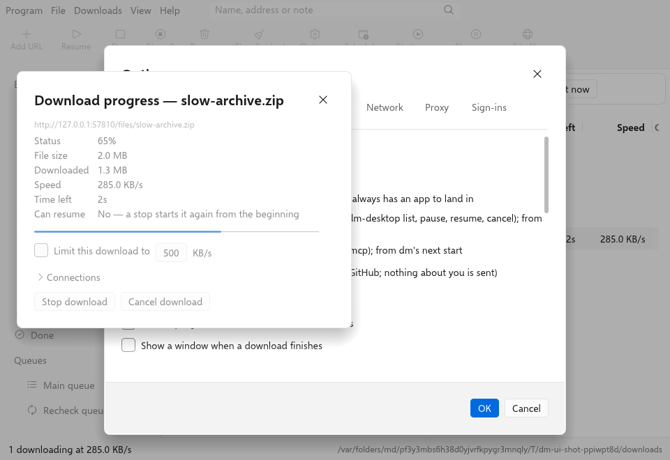
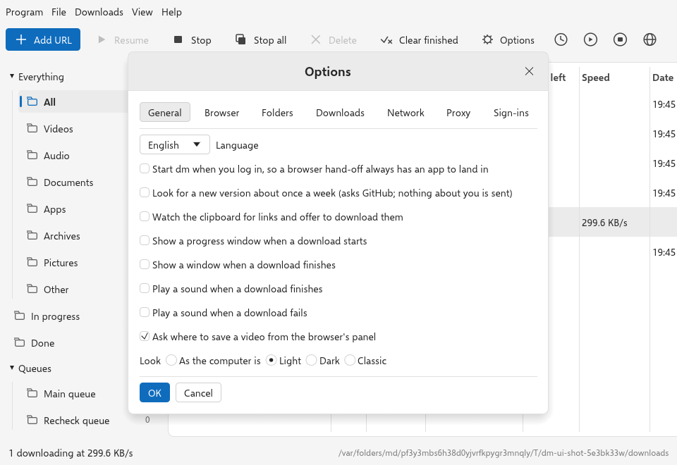

# How dm works

The technical overview: how the app and the extension fit together, how
dm is measured, and how to build it. To install dm, see the
[README](../README.md).

A download manager in the classic desktop shape: a desktop app that does the
downloading, and a browser extension that catches downloads and hands them
to it. Both are Rust — the app natively, the extension compiled to
WebAssembly.

dm splits a file across several connections, resumes what was interrupted,
keeps a queue, and takes the downloads you start by clicking a link — the
things a download manager is used for.

```
  a click on a link in the browser
        │
        ▼
  the extension: is it a file type the app catches?    (no: the browser keeps it)
        │  native messaging: download.start {url, referrer}
        ▼
  dm, the app: can it fetch this itself?               (no: the browser keeps it)
        │
        ├── probe: how big, can it resume?
        ├── split into ranges, fetch them all at once
        └── join, sort into its folder, show it in the queue
```

Works with Chrome, Edge, Brave, Vivaldi, Opera and Firefox, on Windows, macOS
and Linux. With no app installed the extension does nothing a browser would notice:
every download stays with the browser.

<picture>
  <source media="(prefers-color-scheme: dark)" srcset="screenshot-dark.png">
  
</picture>

<sub>The window, light or dark as the computer is (Options › General › Look
also offers the classic look): one file finished and sorted under Archives,
one in flight, one the server refused, one waiting in the Main queue. Rendered offscreen from the real window against a queue the
engine really was serving — the sizes and states are its, not a mock-up's.
`DM_SHOTS=docs cargo test -p dm-desktop --test window shots` (from
`desktop/`) takes them again.</sub>

### How the window is built and held

The window has menus, a toolbar, a category tree, columns, a row menu, and
its dialogs: Add URL, Download details, a progress window with each
connection, Download complete, Properties, Add numbered series, Files on a
site, Scheduler, Speed limiter, Options. It is held together like this:

- **A command registry** (`desktop/crates/dm-desktop/src/commands.rs`). The
  menus, the toolbar, the row menu, the keyboard and the control protocol
  all run the same named commands.
- **Window tests that click every control by its name**
  (`desktop/crates/dm-desktop/tests/window.rs` and `tests/window/`): every menu item, toolbar
  button and row-menu item is clicked through the accessibility tree and
  checked for what it does (`every_menu_item_clicked_does_what_it_says`,
  `every_toolbar_button_clicked_does_what_it_says`,
  `every_row_menu_item_clicked_does_what_it_says`); the others drive each
  control against a real queue.
- **A control protocol** (`control.rs`): `dm-desktop --control <port>` takes
  JSON lines on loopback with a private token, to list and run commands,
  add downloads, run a batch of up to 256 steps, read the window back and
  take screenshots. `--headless` runs dm with no window at all, and
  `dm-desktop mcp` serves the same as tools to an AI client over the Model
  Context Protocol.
- **A server zoo with a ratchet** ([docs/zoo.md](zoo.md)): 31 ways real
  servers behave — lying ranges, cut-off bodies, redirect loops, names only
  in a header — each with what dm must do, held to a floor that only rises,
  with curl fetching the same files as a second opinion.
- **Never crash on outside input.** No `unwrap`, `expect` or `panic` in
  shipped code, enforced by clippy in every crate, and every reader of
  outside data fuzzed with random and hostile input — weekly at depth.
- **A scorecard** ([docs/scorecard.md](scorecard.md)) generated by
  `cargo xtask scorecard`, and `cargo xtask layers` holding the crates to
  their shape.

### Free, and it stays free

dm costs nothing and needs nothing that costs money: no account, no server,
no subscription, no paid service behind it. It contains no analytics, no
crash reporting and no tracking — `cargo xtask privacy` fails the build if a
crate that reports anywhere appears, or if shipped code names any address
but the project's own release page (read only when you check for updates or
open Help). Building, testing and releasing use only free tools and GitHub's
free runners. The installers are not code-signed, because signing
certificates are sold; see [docs/RELEASING.md](RELEASING.md) for what
that means on first launch.

<picture>
  <source media="(prefers-color-scheme: dark)" srcset="progress-dark.png">
  
</picture>

## Install

```sh
git clone https://github.com/pranavo72bex/Easy-Download-Manager
cd Easy-Download-Manager
make install
```

That builds and installs the desktop client, builds the extension (Rust to
WebAssembly — the wasm32 target and the matching `wasm-bindgen` CLI are
added if missing), and registers the client with every installed browser so
the extension can reach it. It then opens `chrome://extensions`, puts the
built folder on your clipboard, and prints the two clicks that remain —
*Developer mode* on, then *Load unpacked* and paste — because **no browser
lets a program install an extension**, not even with developer mode on.
Chrome took the `--load-extension` flag out of its release builds in version
137 for exactly this reason. That boundary is deliberate and it is a good
one: it is what stops any installer adding something that reads every page
you visit. A download manager whose extension is on the Web Store can get to
one click, because an installer may name a Store extension in a policy.

```sh
make register              # tell the browsers where dm is (done by make install)
make register EXT_ID=<id>  # also allow a Chrome Web Store build's id
make doctor                # what is installed, what is missing
make uninstall             # all of it back out
```

The unpacked Chrome build's id is fixed by the public key in its manifest
(`fojpndfjodldkfbamkofdmnfedgjjejo`) and Firefox's by its manifest
(`easy-download-manager@pranavo72bex.github.io`), so registering needs no
id unless the extension came from a store. `make help` lists the rest. `PREFIX=/usr/local sudo make install`
installs system-wide instead of under `~/.local`.

### Or by hand

```sh
sh scripts/package.sh                         # dist/chrome, dist/firefox and their zips
(cd desktop && cargo build --release -p dm-desktop)
desktop/target/release/dm-desktop --register  # from a copy outside ~/Downloads on macOS
```

**Chrome, Edge, Brave, Vivaldi, Opera** — `chrome://extensions`, turn on
**Developer mode**, **Load unpacked** → `dist/chrome`.

**Firefox** — `about:debugging#/runtime/this-firefox`, **Load Temporary
Add-on** → `dist/firefox/manifest.json`. A temporary add-on is removed when
Firefox closes. People install the released extension from
[Firefox Add-ons](https://addons.mozilla.org/en-US/firefox/addon/dm-download-manager/).

On macOS the client must not be registered from `~/Downloads`, `~/Desktop`
or `~/Documents`: a browser is not allowed to run a program from those, and
the failure is silent — the host hangs in the loader and the extension
reports that dm did not answer. `--register` refuses such a path and says
why. Install to `/Applications` (or `make install`) and register that copy.

## Using it

| | |
|---|---|
| **Click a download link** | If it is one of the file types dm catches, the browser's download is paused, handed to dm, and removed from the browser's list once dm has it. dm's window shows it. |
| **Right-click a link** | *Download link with dm* — any link, whatever its type, and magnets. |
| **Right-click a video or audio** | *Download media with dm*. A player that streams from a `blob:` address has no file to fetch; its page is handed over instead, and dm resolves it with yt-dlp. |
| **Right-click a page** | *Download all links with dm*: the page's links, in dm's list to pick from. |
| **The toolbar button** | A popup: whether the dm app answers, a switch for catching downloads, a switch for the "Download video" panel on this site, and **Open dm**. It downloads nothing. |
| **No app** | A caught download stays with the browser as if dm were not there. The menus and the button say, in a notification, that dm isn't connected to this browser yet and to open dm (again, if it is open), with `--register` for advanced users; the popup says the same and hides Open dm. |
| **A link only the browser can fetch** | dm asks the server once before it takes a download from the browser. A file behind a sign-in (whose cookies stay in the browser) is refused by dm and the browser finishes it. |
| **Private windows** | Their downloads are left alone, so nothing from them lands in dm's queue or history. |

## The desktop client

`desktop/` is all Rust: `dm-core` is the
engine and has no idea a screen exists; `dm-shell` is the settings, the
browser hand-off and startup; `dm-desktop` is the window, drawn with egui —
no web view, no Electron, no WebKit.

```sh
cd desktop
cargo run -p dm-desktop       # the window
cargo test --workspace        # the engine against a real HTTP server, a loopback BitTorrent
                              # swarm, and the window driven through its accessibility tree
cd crates/dm-desktop && cargo packager --release   # a .dmg, .deb, AppImage or installer for this machine
```

The installers are not signed with a paid certificate, so the first launch
needs a nudge: on macOS, right-click the app and choose Open rather than
double-clicking, and on Windows tell SmartScreen to run it anyway. That is
Gatekeeper working as designed — see [RELEASING.md](RELEASING.md) for what
is signed and what a certificate would change.

To have the browser hand downloads to it:

```sh
dm-desktop --register [<store extension id>]
```

On macOS the binary must not live in `~/Downloads`, `~/Desktop` or
`~/Documents` — a browser is not allowed to run a program from those, and the
failure is silent. Install to `/Applications` and register that;
`--register` refuses a binary in one of them and says why.

### What else the client does

| | |
|---|---|
| **Archives** | A finished `.zip` is extracted from its row menu: **Extract here** (a new folder beside it) or **Extract to…** (a new folder inside one the person picks). `dm-core`'s `extract.rs` judges every entry before it writes any: a path that leaves the folder (`..`, absolute, drive, backslash), a symlink or device file, a password, a repeated name (also in another case) or totals of entries, bytes and compression ratio past its limits fail the whole archive; the bytes actually written are counted against the sizes the header claims; the folder is always new, so nothing is replaced; the archive is kept and nothing extracted is opened or run. Only Deflate and Stored entries — the `zip` crate is built without its C-backed codecs |
| **Live streams** | RTMP, RTSP and MMS are recorded as they come (`live.rs`). Options › Downloads › *Stop recording a live stream after, minutes* ends a recording the way Stop does — the file closed first — and keeps and places what was recorded; 0 records until the stream ends or Stop |
| **Command line** | `dm-desktop list`, `status ID`, `pause`, `resume`, `cancel ID…`, `--json` (`cli.rs`): another client of the control protocol, so there is one engine and nothing new listens. dm must run with `--control`; exit codes are 0 done, 1 refused, 2 misuse, 3 no dm |
| **Watched folder** | `app/watch.rs`: every five seconds a folder named in Options is read for links saved as `.url`, `.webloc`, text or `.torrent`, read as a drop is read; handled files move to its `done` folder |
| **Site rules** | `Settings::with_site_rule` gives a site's downloads a folder and a speed of their own at the moment a row is added, whatever the way in; what a person chose for one download stands |
| **Checking and naming** | Properties shows a finished file's SHA-256 (hashed on the app's runtime) and checks a pasted digest; Move/Rename of several files takes a `{n}`/`{name}` pattern |
| **Closing the window** | With a tray, closing hides the window and the queue keeps going. On Wayland a program cannot hide or unminimize its own window (winit's `set_visible` does nothing there), so dm minimizes it and keeps drawing; the task manager restores it |

Down the left is a rail of places, and each is a filter over the one list
rather than a list of its own — by state, or by the kind of file, with a count
beside each that is the same list counted once. Search narrows whichever place
you are in. Start All and Pause All are one command each rather than one per
row, so pausing forty downloads rewrites the queue once.

It is where the downloading happens — several connections per file, resume
from what is already on disk, a queue with a limit — and it keeps its own
settings rather than borrowing the browser's.

<picture>
  <source media="(prefers-color-scheme: dark)" srcset="settings-dark.png">
  
</picture>

| | |
|---|---|
| **Transfer** | Connections per file, files at once, and one speed ceiling shared by every connection of every download — the only kind of limit worth setting. |
| **Categories** | Finished files sorted into Videos, Audio, Documents and the rest, configurable per kind. |
| **Schedule** | A window in local time that may wrap past midnight, because "between 23:00 and 07:00" is the case people have. Outside it the queue stops and resumes from its part files later. A download paused on purpose stays paused. |
| **Proxy** | HTTP, HTTPS, SOCKS4 or SOCKS5, with credentials if it needs them. A proxy that cannot be built is reported rather than quietly bypassed. |
| **Checksums** | Paste a published SHA-256, SHA-512 or MD5 onto a row. A mismatch fails the download and removes the file — a file known to be wrong should not sit in the downloads folder looking like every other one. |
| **Mirrors** | Give it a `.meta4` or `.metalink` and it probes every mirror, drops any that disagree about the length, and hands each range its own mirror so all of them are working at once. The document's own checksum is used without being asked for. |
| **History** | Finished rows stay, with the time they finished, until you clear them. |
| **BitTorrent** | Paste a magnet or a `.torrent` and the client joins the swarm, fetches every piece, and reports on the same row as any other download — one speed ceiling covers both. The extension cannot do this at all: it has no sockets, so a magnet is a download only the app can take. |

The browser extension hands downloads to it once the client has been
registered with `--register`.

## What the extension catches

The extension has no settings of its own. Which downloads it takes is the
app's choice, kept in the app's settings (*Options › Browser*) rather than in the
add-on, and sent to the extension
when it asks (`settings.get`, re-asked at most a minute later):

```json
"catch": {
  "enabled": true,
  "extensions": ["zip", "rar", "7z", "exe", "msi", "dmg", "iso", "mp4", "mkv", "mp3", "pdf", "…"],
  "minSizeKb": 0,
  "skipHosts": []
}
```

| | |
|---|---|
| **enabled** | Off: every download stays with the browser. The menus and the button still hand things over when asked. |
| **extensions** | File types, matched against the name the browser chose, the URL, and the type the server sent. The default list: archives, installers and disk images, video, audio, documents, and `.torrent`. Empty means every type. |
| **minSizeKb** | Smaller downloads stay with the browser. An unknown size is not a reason to leave one. |
| **skipHosts** | Sites whose downloads stay with the browser, subdomains included. |

The file is `settings.json` under dm's home (`~/Library/Application
Support/dm-engine` on macOS, `~/.local/share/dm-engine` on Linux), and
Options › Browser edits them.

## How the hand-off works

**The extension** is Rust (`browser/`, crate `dm-catcher`) compiled to
WebAssembly with wasm-bindgen. Every decision — which downloads are
candidates, what a menu click hands over, how long an answer about the app is
believed — is plain Rust tested on the build machine; the browser side reads
events into those types and does what they say. The only hand-written
JavaScript is `extension/background.js`, a loader of a few lines, and it
cannot be Rust: a Manifest V3 background must register its listeners on its
first turn, before any WebAssembly can have loaded, so the loader registers
them and forwards each event once the module is ready. Permissions:
`downloads`, `contextMenus`, `nativeMessaging`, `notifications`, `storage`
(the app's catch rules, kept so a download is held at once; the popup's
switches), `webRequest` with access to all sites (the media a page's player
loads, read only, for the panel's list), plus a page
script (`extension/content.js`) that, once a page shows media, asks the
background to put the panel's code into its frame (`scripting.executeScript`
with `pkg/panel.js`, the same Rust module built as a plain script with its
WebAssembly written in), and that code draws the "Download video" panel over
players and reads nothing else. The page fetches nothing of the extension's,
and no file of it is offered to pages (no `web_accessible_resources`). On a
site whose security policy forbids WebAssembly, Chrome holds the page script
to that policy, so the panel cannot load there; the right-click menu still
works.

**The protocol** is native messaging, and its vocabulary, message types and
the catch rule are one Rust crate (`desktop/crates/dm-protocol`) used by both
sides, where it used to be two languages kept in step by hand:

| extension sends | host answers |
|---|---|
| `engine.hello` | `engine.hello` with the app's version and whether it has yt-dlp |
| `settings.get` | `settings.get` with the `catch` rules |
| `download.start` `{id, url, referrer, caught}` | `download.started`, or `download.failed` with the reason |

**The host** is the desktop binary itself. A native messaging manifest names
an executable and cannot pass it arguments, so the binary works out that a
browser started it from what each browser passes as its first argument,
and answers only an extension it knows: the ids built in and any a manifest
it wrote allows (`shell::launcher_known`; the browser's own manifest check
is the one that counts, this holds where something else started dm in a
browser's name). It asks the server once (through the saved proxy, with the page as referrer)
before taking a download the browser is holding (`caught`), writes the request into a directory the running app
watches, starts the app if it is not running (or rings a running one's
doorbell, a loopback port it wrote to `inbox/bell`, so the request is read
at once rather than at the next half-second poll), answers, and exits with
the port the browser owns. It is one-way past `download.started`: the app's
window is where the download is.

**Never losing a download.** A caught download is paused while the app is
asked, and cancelled only once the app says it has it. No app, no answer, a
refusal, or a server that will not serve dm: the browser's download is
resumed — or, where it cannot be (Firefox cannot resume what a server will
not range), started again, marked so the extension does not catch it a
second time. A download the extension itself started is never caught.

## What it cannot do

- **Cookies stay with the browser, unless you say otherwise for a site.**
  The app is a separate program and does not have the browser's session. A
  download that needs it is refused by dm before anything is taken and
  finishes in the browser — kept, but not accelerated. The toolbar popup's
  "Hand over this site's sign-in" changes that for one site: the extension
  asks the browser for its `cookies` permission the first time, and from
  then on that site's cookies go with its downloads as the `Cookie` header
  the browser would have sent, to the host's probe and to the app, where
  the row keeps them so a resume is signed in too.
- **Without the app it does nothing.** There is no longer a downloader in the
  browser: with no app, downloads are the browser's own.
- **Windows has run only on CI's machines.** Windows reads host manifests
  through the registry; `--register` writes the keys through `reg.exe`
  (unit-tested on every OS), and CI installs the NSIS installer, runs
  `smoke.py` and the whole of `app-check.py` against it. A person's Windows
  desktop (a GPU driver, the tray, SmartScreen, a login item) is checked by
  hand from [windows-checklist.md](windows-checklist.md).
- **The catch rules are Options › Browser**, kept in `settings.json`.
- **A browser's context menu is clicked with real input only in Firefox on
  Linux** (`linux-firefox-check.sh`); elsewhere the checks call the handler
  the menu calls, from the worker.

## Development

Every check, what it proves and how to run it (including in Docker, on
Linux, under Wayland and KDE's compositor) is in [testing.md](testing.md).
The common ones:

```sh
cd browser && cargo test                       # the extension's decisions, on the host
cd browser && cargo clippy --target wasm32-unknown-unknown -- -D warnings
sh scripts/package.sh                          # build the WebAssembly, dist/chrome, dist/firefox, the zips
python3 scripts/chrome-check.py                # Chrome for Testing, handing off to a real dm

cd desktop && cargo test --workspace           # engine, protocol, shell and window tests
cd desktop && cargo clippy --workspace --all-targets -- -D warnings
python3 scripts/app-check.py                   # drives the built binary: lock, hand-off, proxy, schedule
sh scripts/linux-check.sh                      # the same, on Linux, in a container
python3 scripts/firefox-check.py [native]      # a real Firefox, when one is installed
```

`chrome-check.py` needs nothing but Python: it downloads Chrome for Testing
(the build that still honours `--load-extension`) into
`~/.cache/dm-chrome-for-testing`, loads `dist/chrome` into a throwaway
profile, registers a copy of the debug binary as the host with a throwaway
`DM_HOME`, and drives it over the DevTools protocol against a local server: a
clicked link handed to dm and fetched with its referrer, the browser's copy
erased, types the app does not list left alone, a cookie-gated file refused
by dm and finished by the browser, the menu's handler, and a download with no
host finishing in the browser.

The window's tests click its controls through egui's accessibility tree —
the same names a screen reader reads — against a real queue fetching from a
server on loopback, and check what each did to the queue.

```
browser/                  the extension, in Rust (crate dm-catcher)
  src/decide.rs           every decision, tested on the host; its parts are decide/ (download,
                          menu, app, media_panel, sites, streams, timing), re-exported from it
  src/web.rs              the browser side: extension APIs, native messaging; web/ holds plumbing,
                          host, settings, streams, handoff, downloads, page, actions
  src/content.rs          the page script's panel; content/ holds rules, dom, build, show,
                          keyboard, visible, events, handoff
extension/
  background.js           the loader: registers listeners, forwards to the WebAssembly
  manifest.json           Chrome, Edge, Brave, Vivaldi, Opera
  manifest.firefox.json   Firefox
  pkg/                    built by scripts/package.sh (not in git)
desktop/
  crates/dm-core/
    download/             one download: mod.rs (options, the entry points), ranged.rs (the
                          range workers, resume), http.rs, mirrors.rs, hls.rs (playlists and
                          live), dash.rs (a DASH stream: fetch both tracks, join), assemble.rs, space.rs (free-disk accounting), files.rs (parts, names)
    queue/                several downloads, a limit, and the states between: mod.rs (the state),
                          runner.rs (what starts and when), actions.rs (pause, resume, cancel,
                          remove), settings.rs, persist.rs, edit.rs, recheck.rs, queues.rs
    plan.rs               how a file is cut into ranges
    probe.rs              size, name, and whether it can be resumed
    progress.rs           smoothed rate and time remaining
    retry.rs              what is worth another attempt, and when
    limit.rs              one speed ceiling, shared
    category.rs           sorting finished files by what they are
    schedule.rs           when the queue is allowed to run
    proxy.rs              routing downloads through a proxy
    checksum.rs           verifying a finished file against a published hash
    metalink.rs           reading a list of mirrors for one file
    torrent.rs            magnets and .torrent files, via librqbit
    dash.rs               DASH manifests read by dm: templates, lists, byte ranges, the picture
                          and sound chosen (the fetching is download/dash.rs)
    stream.rs, tsmux.rs   HLS playlists, and transport streams put into MP4 (tsmux/: demux,
                          samples, sound, headers, tracks)
    mp4mux.rs, mkvmux.rs  picture and sound joined into one MP4 or WebM (mp4mux/: read, write, text)
    live.rs, rtmp.rs, rtsp.rs, mms.rs   live streams recorded as they come (rtmp/: amf, wire,
                          recorder, connect, session)
    youtube.rs            a YouTube page read by dm itself (the player API, the solver scripts)
    ytdlp.rs, tools.rs    pages handed to yt-dlp, and the tools dm fetches and checks
    ytdlp/fetch.rs        a page read by yt-dlp, its streams fetched by dm's engine
    ytdlp/choices.rs      the panel's list of qualities (page data first, yt-dlp as fallback)
    ytdlp/page_data.rs    a YouTube watch page's own player data, read as that list
    ytdlp/readings.rs     yt-dlp's readings kept for the download, and the marker while one is made
    ytdlp/refusal.rs      a failed yt-dlp run said in words a person can act on
    ytdlp/process.rs      yt-dlp's process trees, ended with everything under them
    extract.rs            a ZIP extracted into a folder of its own, refusing hostile entries
    control.rs, cookies.rs, auth.rs, ftp.rs   the stop flag, sign-ins, FTP (ftp/: transport,
                          target, reply, session, listing, transfer)
  crates/dm-protocol/     what the extension and the host say, and the catch rule
  crates/dm-shell/        settings, the browser host, --register, one-instance lock, startup
  crates/dm-desktop/      the window, in egui; the tray, login item, notifications
    src/table.rs, theme.rs   the download list and the look; table/ and theme/ hold their parts
    src/main.rs           startup; platform.rs, tray.rs, window.rs, hidden.rs, signals.rs, login.rs are its parts
    src/app/              the window's state (mod.rs) and what it does, one concern per file:
                          sync.rs (queue ↔ rows), commands.rs (enabled/run), control.rs (the control protocol),
                          places.rs, ui.rs, menus.rs, tree.rs, bars.rs, drops.rs, search.rs, lists.rs, files.rs…
    src/dialogs/          one file per dialog (add.rs, options.rs, file_info.rs…); frame.rs and
                          controls.rs are the toolkit they share; state.rs holds the open dialogs
    src/commands.rs       the command registry every menu, key and script runs
    src/cli.rs, mcp.rs, control.rs   the command line, the MCP server, the control protocol
    tests/window.rs       indexes tests/window/*.rs, grouped by what they check (options, dialogs,
                          keyboard, layout, lists, commands, control…); support.rs is the shared harness
  xtask/                  cargo xtask scorecard | layers | privacy | secrets
  packaging/PKGBUILD      the Arch package
shared/naming-cases.json  filename cases the engine's naming is held to
scripts/package.sh        builds the extension and the store zips
scripts/chrome-check.py   the extension in Chrome for Testing, handing off to dm
scripts/firefox-check.py  the extension in a real Firefox
scripts/app-check.py      the built binary, driven
```

## Licence

MIT — see [LICENSE](../LICENSE).
